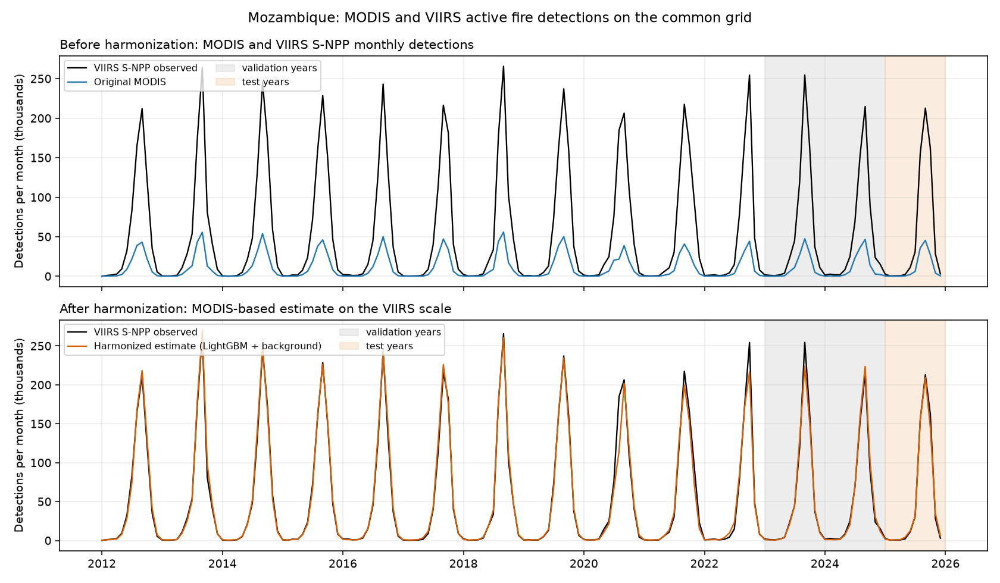

# NYELETI AI

**NASA MODIS-VIIRS Fire Data Harmonization and Burning Activity Calendar**

NASA Space Apps Challenge 2026, challenge 09: *Harmonization of MODIS and
VIIRS Hot Spots*. First case study: Mozambique.

MODIS has recorded active fires since 2000 at 1 km; VIIRS has done so since
2012 at 375 m and reports about five times as many detections over
Mozambique. NYELETI AI learns the relationship between the two sensors in the
years they share and uses it to express the whole MODIS record on the VIIRS
scale, so that 25 years of fire activity can be read as one series: a daily
calendar of burning activity for the country, each province, each district or
any area drawn on the map.

Everything shown comes from NASA FIRMS files. The original MODIS and VIIRS
values are never overwritten, and harmonized values are always labelled as
estimates.



## Results

Independent test year 2025, never seen in training (2012-2022) or model
selection (2023-2024). Reference: VIIRS S-NPP observed. HFAI is the activity
index defined in [docs/methodology.md](docs/methodology.md).

| HFAI by province and day | MAE | RMSE | R² | Bias |
|---|---|---|---|---|
| Original MODIS | 40.9 | 122.6 | 0.572 | -57.6 % |
| Linear regression | 28.2 | 79.7 | 0.819 | +0.3 % |
| Quantile mapping | 31.0 | 92.2 | 0.758 | -2.4 % |
| LightGBM + background (ours) | 24.4 | 65.0 | 0.880 | -1.1 % |

- National detections in 2025: MODIS 122,267, VIIRS 609,745, harmonized
  601,937 (98.7 % of VIIRS).
- High-activity days by province: recall rises from 0.34 (original MODIS) to
  0.72, with precision 0.82.
- By province and month: R² 0.981.

What the model does not do well is stated with the same weight in
[docs/model_card.md](docs/model_card.md): the estimate of a single 5 km cell
on a single day is weak (R² 0.24), original MODIS has a lower MAE at that
level, the linear regression has a slightly smaller bias, and gaps in MODIS
(Aqua, 16 August to 1 September 2020) pass into the harmonized series.

All numbers are written by the evaluation script to
[docs/results.md](docs/results.md); none is typed by hand.

## The application

| Module | What it shows |
|---|---|
| Dashboard | Totals, yearly and monthly series, strongest anomalies |
| Map | MODIS, S-NPP and NOAA-20 detections with filters, harmonized grid, selection of a province, a district or a drawn polygon |
| Burning Activity Calendar | Day, month, season and year views, four activity classes, year-to-year comparison |
| AI Harmonization Engine | Before/after series, metrics against the baselines, feature importance, model details |
| Anomaly Detection | Unusual periods against the seasonal reference, with the reasons |
| Critical Burning Periods | Periods above an adjustable percentile, season timing, trend, recurrent districts |
| Reports | PDF report, CSV series, CSV anomalies, GeoJSON grid for the selected area and period |
| Data | Files downloaded, checks, coverage of each sensor |

Interface in English and Portuguese.

## Repository

    backend/app/        FastAPI application (api, services, database, models)
    frontend/src/       React + TypeScript interface (pages, calendar, components, services)
    ml/
      config.py         study area, grid, split, paths
      preprocessing/    grid, pairs and features, background rate
      training/         LightGBM harmonization, baselines, Isolation Forest
      evaluation/       metrics, evaluation report, resolution comparison
      inference/        harmonized estimates for the full record
      anomaly/          seasonal features and detector
      artifacts/        trained models with their metadata and metrics
      data/             downloaded and derived data (not versioned)
    scripts/            pipeline steps, from download to database
    docs/               methodology, data sources, model card, generated reports, figures
    tests/              unit tests

## Running it

Requirements: Python 3.12, Node 20, about 5 GB of disk (3.7 GB of it for the
downloaded and derived data; the optional grid comparison adds 0.8 GB) and
8 GB of RAM for the full pipeline.

```bash
python -m venv .venv
source .venv/bin/activate            # Windows: .venv\Scripts\activate
pip install -r requirements.txt
```

### 1. Build the data and the models

```bash
python -m scripts.run_pipeline
```

| Step | Module | Output |
|---|---|---|
| download | `scripts.download_firms` | NASA FIRMS yearly files and `manifest.json` |
| boundaries | `scripts.download_boundaries` | country, provinces, districts |
| clean | `scripts.clean_data` | validated records, `docs/data_quality.md` |
| grid | `scripts.aggregate_grid` | cell x day tables per sensor |
| pairs | `scripts.build_pairs` | MODIS-VIIRS pairs and features |
| train | `ml.training.train_harmonization` | LightGBM models, baselines, background rate |
| evaluate | `ml.evaluation.evaluate_model` | `docs/results.md`, figures, `metrics.json` |
| harmonize | `ml.inference.harmonize` | estimates for 2001-2025 |
| calendar | `scripts.build_calendar` | application database (DuckDB) |
| anomaly | `ml.training.train_anomaly` | Isolation Forest and flagged days |
| figures | `scripts.make_figures` | remaining figures in `docs/figures/` |

`--from <step>`, `--to <step>` and `--only <step>` run part of the chain.
Downloads are incremental: files already present are kept. Stop the API
before running the `calendar` or `anomaly` steps, because they write to the
database.

The grid size comparison is separate, because it retrains the model for each
size: `python -m ml.evaluation.compare_resolutions`.

### 2. Start the application

```bash
cd frontend && npm install && npm run build && cd ..
uvicorn backend.app.main:app --port 8000
```

Open <http://localhost:8000>. The API documentation is at `/docs`.

For development, run `npm run dev` in `frontend/` (port 5173, proxied to the
API on port 8000).

### 3. Tests

```bash
python -m pytest tests
```

### Docker

`Dockerfile` and `docker-compose.yml` build the interface and serve it with
the API in one container, with `ml/data` mounted from the host:

```bash
docker compose run --rm pipeline     # builds the data and the models
docker compose up app                # http://localhost:8000
```

Docker was not available on the machine where the project was developed, so
these two files are provided untested; the route above is the verified one.

### Another country

Set `NYELETI_COUNTRY` (name used by FIRMS) and `NYELETI_ISO3` before running
the pipeline, with a separate `NYELETI_DATA_DIR`. The model must be retrained:
the MODIS-VIIRS relationship depends on the fire regime.

## API

| Endpoint | Content |
|---|---|
| `GET /api/areas` | country, provinces and districts; `/api/areas/geojson`, `/api/areas/resolve` for a drawn polygon |
| `GET /api/fires` | detections by period, sensor, confidence, day/night, bounding box |
| `GET /api/calendar` | activity by day, month, season or year, with classes |
| `GET /api/harmonization` | MODIS observed, VIIRS observed and harmonized series; `/api/harmonization/grid` for the map |
| `GET /api/anomalies` | flagged periods; `/api/anomalies/series`, `/api/anomalies/overview` |
| `GET /api/trends` | seasonality, season timing, trend; `/api/critical` for critical periods |
| `GET /api/model/metrics` | metrics, baselines, parameters and feature importance of the active model |
| `GET /api/reports` | PDF, CSV and GeoJSON exports |

Endpoints that work on an area accept `area_id`, a drawn polygon (`aoi`,
GeoJSON) or a bounding box (`bbox`); the default is the whole country.

## Documentation

- [Methodology](docs/methodology.md)
- [Data sources](docs/data_sources.md)
- [Model card](docs/model_card.md)
- [Results](docs/results.md) (generated)
- [Grid resolution comparison](docs/resolution_comparison.md) (generated)
- [Data quality report](docs/data_quality.md) (generated)

## Design choices and limits

- **Database.** The plan was PostgreSQL with PostGIS. The application uses
  DuckDB, a single file built by the pipeline, with the same tables
  (`fire_detections`, `geographic_areas`, `harmonized_activity`,
  `calendar_activity`, `fire_anomalies`, `model_versions`,
  `harmonization_runs`). It needs no server, which keeps the project
  reproducible with one command; spatial operations are done with Shapely and
  GeoPandas when the database is built.
- **Period.** 2001-2025. The FIRMS yearly archive did not include 2026 when
  the data were downloaded, so the test period is 2025 instead of 2025-2026.
- **Grid.** 5 km, after training and testing the same model at 1, 5 and
  10 km. On 2025 province-day detection counts: 1 km RMSE 205 (R² 0.790),
  5 km RMSE 159 (R² 0.874, bias -1.3 %), 10 km RMSE 150 (R² 0.887, bias
  -3.3 %). 1 km is clearly worse, because MODIS cannot place fires that
  finely. 10 km has a slightly lower error than 5 km but a larger bias and a
  map four times coarser, so 5 km was kept; it is a trade-off, not a clear
  win. See the comparison report.
- **Before 2012** the harmonized series is an estimate that cannot be checked
  against VIIRS, and 2001-2002 have incomplete MODIS coverage.
- **Anomalies** describe unusual past activity. The project makes no forecast.
- Active fire detections are not burned area and say nothing about cause.

## Data and credits

Active fire data: NASA FIRMS, MODIS Collection 6.1 (MCD14ML) and VIIRS 375 m
(VNP14IMGTML, VJ114IMGTML). We acknowledge the use of data from NASA's Fire
Information for Resource Management System (FIRMS)
(https://earthdata.nasa.gov/firms), part of NASA's Earth Science Data and
Information System (ESDIS). Base imagery: NASA GIBS. Boundaries:
geoBoundaries. Base map: © OpenStreetMap contributors.

NASA does not endorse this project.

## Licence

Code under the MIT licence, see [LICENSE](LICENSE).
